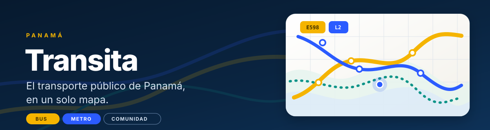

# Transita

**Muévete por Panamá con más claridad.**

Transita busca hacer más sencillo moverse por Panamá. La app reúne información de rutas y paradas para ayudar a las personas a explorar sus opciones y orientarse durante el recorrido.

## La experiencia

- Explorar rutas y paradas de bus y Metro.
- Consultar horarios publicados y la información disponible del servicio.
- Seguir un recorrido y conocer las próximas paradas.
- Compartir reportes sobre incidencias.

## Estado

Transita está en desarrollo para Android y todavía no está disponible para descarga pública.

## Créditos

Los datos cartográficos incluyen información de [OpenStreetMap contributors](https://www.openstreetmap.org/copyright). Transita es un proyecto independiente y no está afiliado a MiBus ni al Metro de Panamá.

Hecho con cariño en Panamá 🇵🇦.
